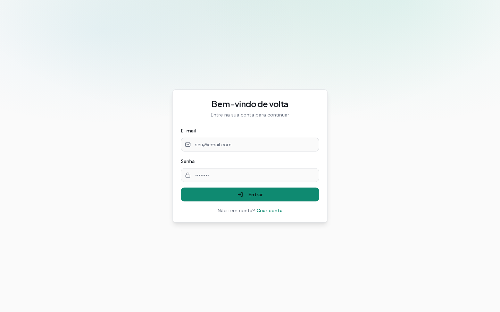
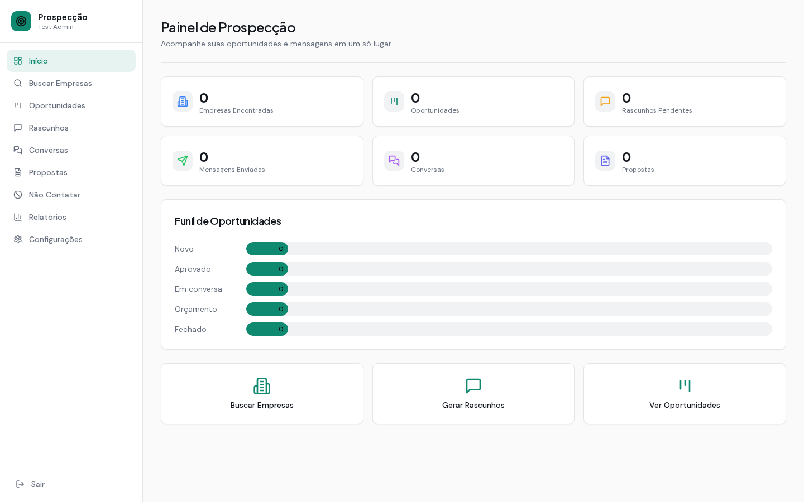
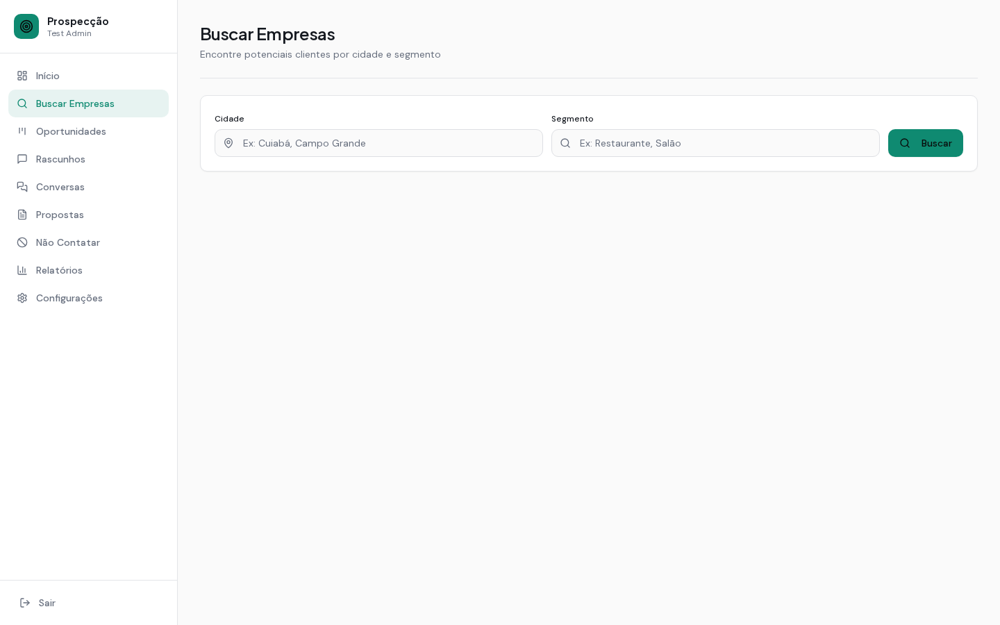
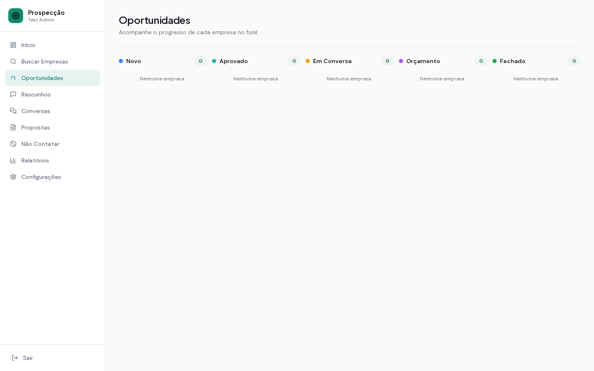

# Assistente de Prospecção de Clientes


Ferramenta para **freelancers que vendem criação de sites** para pequenos negócios. Ela encontra empresas locais por cidade e segmento usando o **OpenStreetMap** (gratuito, sem chave de API), identifica quais têm **potencial para um site novo** e organiza todo o processo comercial: funil de oportunidades, rascunhos de mensagens gerados com IA, conversas, propostas e relatórios.

> As mensagens **nunca são enviadas automaticamente**: a ferramenta prepara o rascunho e você revisa e envia pelo seu WhatsApp ou e-mail.

🔗 **Aplicação online:** [painel-prospeccao.abacusai.app](https://painel-prospeccao.abacusai.app)

---

## ✨ Funcionalidades

- **🔎 Busca de empresas** — pesquisa por cidade + segmento (ex.: "Cuiabá" + "restaurante") via Nominatim/OpenStreetMap, direto do navegador e respeitando o limite de uso da API.
- **🎯 Classificação de potencial** — cada empresa recebe nível *alto*, *médio* ou *baixo*: sem site, só com rede social ou já com site próprio.
- **📊 Funil de oportunidades (Kanban)** — etapas *Novo → Aprovado → Em Conversa → Orçamento → Fechado*, com anotações por empresa.
- **✍️ Rascunhos com IA** — mensagens personalizadas de primeiro contato, de acordo com o tom escolhido (profissional, amigável ou casual) e os serviços que você oferece. Dá para copiar o texto ou abrir o link do WhatsApp/e-mail já preenchido.
- **💬 Conversas** — histórico de contato com cada empresa e sugestão de resposta gerada por IA.
- **📄 Propostas** — criação de orçamentos com vários itens e cálculo automático do total, vinculados a uma oportunidade.
- **🚫 Lista "Não Contatar"** — empresas que pediram para não receber mensagens ficam bloqueadas para novos rascunhos.
- **📈 Relatórios** — funil de conversão, taxa de resposta, mensagens por canal e totais gerais.
- **⚙️ Configurações** — seus dados, serviços oferecidos, tom das mensagens, limite diário de rascunhos e opção de transparência sobre o uso de IA.
- **🔐 Autenticação** — login com e-mail e senha (NextAuth), cadastro de novos usuários e troca obrigatória de senha no primeiro acesso.

## 🖼️ Capturas de tela

| Login | Painel |
|---|---|
|  |  |

| Buscar Empresas | Oportunidades |
|---|---|
|  |  |

## 🛠️ Tecnologias

| Camada | Tecnologia |
|---|---|
| Framework | [Next.js 16](https://nextjs.org/) (App Router) + [React 19](https://react.dev/) |
| Linguagem | [TypeScript](https://www.typescriptlang.org/) |
| Estilo / UI | [Tailwind CSS](https://tailwindcss.com/), componentes Radix UI, Framer Motion |
| Banco de dados | [PostgreSQL](https://www.postgresql.org/) com [Prisma ORM](https://www.prisma.io/) |
| Autenticação | [Auth.js / NextAuth v5](https://authjs.dev/) (credenciais + bcrypt) |
| Dados de empresas | [Nominatim / OpenStreetMap](https://nominatim.org/) |
| IA | API de chat da [Abacus.AI](https://abacus.ai/) |

## 📁 Estrutura do projeto

```
.
├── app/
│   ├── (auth)/             # Login e cadastro
│   ├── (app)/              # Área logada
│   │   ├── dashboard/      # Painel inicial com indicadores
│   │   ├── buscar/         # Busca de empresas (OpenStreetMap)
│   │   ├── oportunidades/  # Funil Kanban
│   │   ├── rascunhos/      # Rascunhos de mensagens com IA
│   │   ├── conversas/      # Histórico e sugestões de resposta
│   │   ├── propostas/      # Orçamentos
│   │   ├── nao-contatar/   # Lista de bloqueio
│   │   ├── relatorios/     # Métricas
│   │   ├── configuracoes/  # Preferências do usuário
│   │   └── alterar-senha/  # Troca obrigatória de senha
│   └── api/                # Rotas de API (empresas, rascunhos, conversas, propostas...)
├── components/             # Componentes de interface (sidebar, UI, gráficos)
├── lib/                    # Cliente Prisma, tipos e utilitários
├── prisma/schema.prisma    # Modelos do banco de dados
├── scripts/                # Seed do banco e teste de autenticação
├── auth.ts                 # Configuração do NextAuth
└── docs/screenshots/       # Imagens deste README
```

## 🚀 Como rodar localmente

### Pré-requisitos

- Node.js 20 ou superior
- PostgreSQL 14 ou superior
- Yarn (via `corepack enable`) ou npm

### 1. Clonar e instalar

```bash
git clone https://github.com/edivaldoeugenio/assistente-prospeccao.git
cd assistente-prospeccao
corepack enable
yarn install
```

### 2. Configurar as variáveis de ambiente

```bash
cp .env.example .env
```

Preencha o `.env`:

| Variável | Descrição |
|---|---|
| `DATABASE_URL` | URL de conexão com o PostgreSQL |
| `NEXTAUTH_SECRET` / `AUTH_SECRET` | Segredo para assinar as sessões (`openssl rand -base64 32`) |
| `NEXTAUTH_URL` | URL base da aplicação (ex.: `http://localhost:3000`) |
| `ABACUSAI_API_KEY` | Chave da Abacus.AI, usada para gerar rascunhos e sugestões |

### 3. Preparar o banco de dados

```bash
npx prisma generate
npx prisma db push
```

### 4. (Opcional) Criar um usuário inicial

```bash
SEED_USER_EMAIL="voce@exemplo.com" SEED_USER_PASSWORD="uma-senha-forte" npx prisma db seed
```

O usuário será obrigado a trocar a senha no primeiro login. Você também pode criar uma conta pela tela **Criar conta**.

### 5. Iniciar o servidor de desenvolvimento

```bash
yarn dev
```

Acesse [http://localhost:3000](http://localhost:3000).

## 📜 Licença

Distribuído sob a licença **MIT**. Veja o arquivo [LICENSE](LICENSE) para mais detalhes.

---

Desenvolvido por **Edivaldo Eugênio**.
